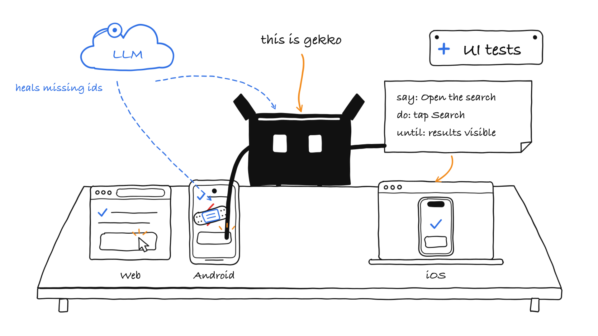
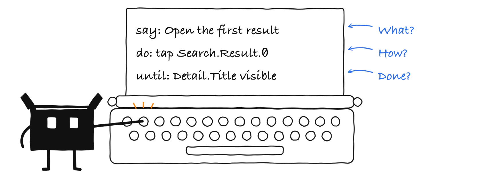
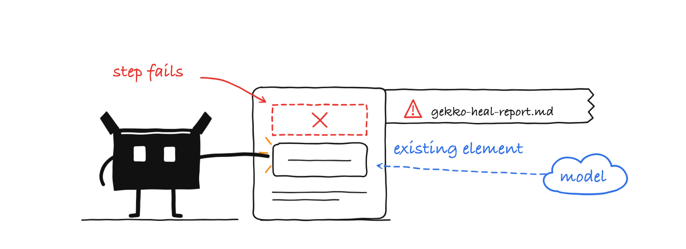
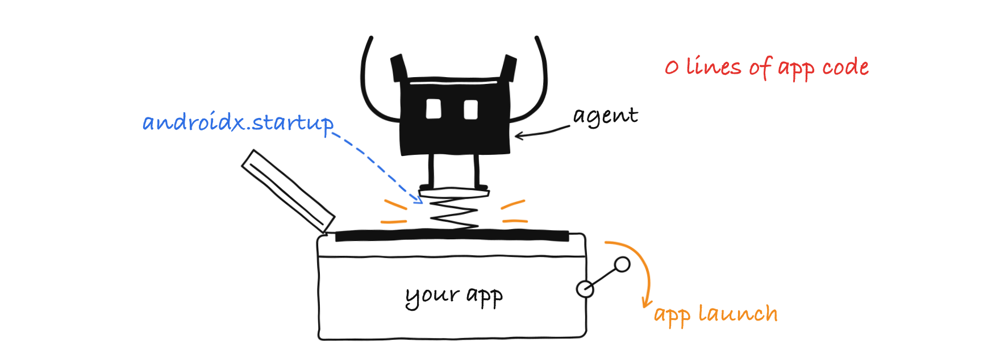
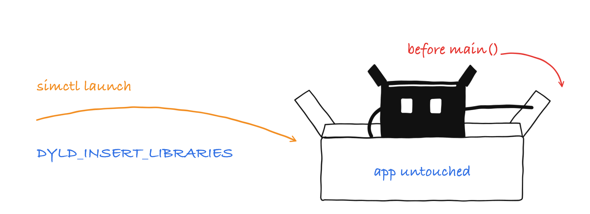
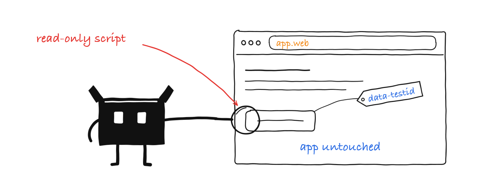

# gekko

[](https://github.com/jakala-germany/gekko/releases)
[](https://central.sonatype.com/namespace/io.github.jakala-germany)
[](https://github.com/jakala-germany/gekko/actions/workflows/ci.yml)
[](LICENSE)

**G**enerate and **E**xecute with **K**otlin to **K**eep-green through **O**bservation

<p align="center">
  
</p>

gekko runs **UI tests written once in YAML on Android, iOS and the web** (Chromium, Firefox and WebKit). It is built to replace slow, hand-written UI-test suites.

https://github.com/user-attachments/assets/95c2ec31-7283-452a-bca5-328fc3194612

## What it does

- **Fast.** On Android and iOS an in-app agent reads the UI tree directly and taps through accessibility actions; on the web a script injected into the page does the same: steps take 10 ms to about 1 s.
- **Write once.** One test file, shared ids, optional `platform:` on steps (one name or a list), `do` or `until` where the platforms differ.
- **Reusable flows.** Login or onboarding is defined once and reused with `use:`. A folder with a `group.yaml` makes its tests share one login: the setup flows run once, the tests follow in one session, and a failed setup skips them.
- **LLM only where it helps.** A tester describes a scenario; Claude (their own subscription) writes and repairs the steps. CI replays the compiled steps, and no model decides whether a test passes.
- **Self-healing on request.** With `--heal`, a missing id does not fail the run: a model picks the element that fits the step's intent, and a warning lists exactly what was missing and what was used instead.

How the CLI, the in-app agent, the system runner and the web bridge fit together: [How gekko works](docs/how-it-works.md).

## Quick start

From zero to a first passing test on an Android app. You need `adb` and a running emulator or device (API 24 or newer).

1. **Install the CLI** (macOS arm64 or Linux x64) and put `~/.local/bin` on your `PATH`:

   ```bash
   curl -fsSL https://raw.githubusercontent.com/jakala-germany/gekko/1.1.0/scripts/install.sh | bash -s -- 1.1.0
   gekko --version
   ```

2. **Add the agent to the debug build.** In the app module (`mavenCentral()` must be in the `pluginManagement` and `dependencyResolutionManagement` repositories of `settings.gradle.kts`):

   ```kotlin
   plugins { id("io.github.jakala-germany.gekko") version "1.1.0" }
   gekko { variants.set(listOf("debug")) }
   ```

3. **Give the elements your test touches an id**: the search tab `Home.Tab.Search` and the search field `Search.Field`, set with `Modifier.testTag("Search.Field")` in Compose or a view id.
4. **Install the debug build** on the emulator: `./gradlew installDebug`.
5. **Create `ui-tests/gekko.yaml`** with the application id (add `androidActivity` when the app has several launcher activities):

   ```yaml
   app:
     android: com.example.app
   ```

6. **Look at the app** from `ui-tests/`. `launch` prints `ok` once the agent answers, `tree` lists the ids on screen:

   ```bash
   gekko launch --fresh
   gekko tree
   ```

7. **Write `ui-tests/tests/first.yaml`**:

   ```yaml
   name: Search is reachable
   steps:
     - say: Open the search
       do: { tap: { id: Home.Tab.Search } }
     - say: The search field is shown
       do: { assertVisible: { id: Search.Field } }
   ```

8. **Run it**: `gekko check && gekko run`

`ui-tests/` can also be a repository of its own, which is what the CI templates expect.

The `gekko-setup` skill does steps 2, 4 and 5 for you and checks the result (see [Setting up an app](#setting-up-an-app)).

**iOS app?** Steps 2 and 4 are Android only. Instead:

1. Build a Debug simulator app (a `.app`).
2. In `gekko.yaml` set `app.ios` (the bundle id) and `ios.agentFramework: installed`.
3. Give the elements an `.accessibilityIdentifier(...)` with the same strings as in step 3.
4. Install and look at the app on a booted simulator. A simulator UDID after `-s` selects iOS by itself; without `-s` add `--platform ios`:

   ```bash
   gekko install --platform ios App.app
   gekko launch --platform ios --fresh
   gekko tree --platform ios
   ```

   Run the tests with `gekko run --platform ios`.

Details: [iOS app in the `gekko-setup` skill](skills/gekko-setup/SKILL.md#ios-app).

**Web app?** Nothing goes into the app, so steps 2 and 4 are not needed. Needs gekko 1.2.0 (not released yet). Instead:

1. Install Playwright and a browser once (needs Node.js 18 or newer): `gekko install -s firefox`.
2. In `gekko.yaml` set `app.web` (the URL of the app).
3. Give the elements a `data-testid` with the same strings as in step 3.
4. Look at the app. A browser name after `-s` (`chromium`, `firefox`, `webkit`) selects the web by itself:

   ```bash
   gekko launch -s firefox --fresh
   gekko tree -s firefox
   ```

   Run the tests with `gekko run -s firefox`.

Details: [Web app in the `gekko-setup` skill](skills/gekko-setup/SKILL.md#web-app).

## A test



```yaml
name: Search
tags: [smoke]
steps:
  - say: Complete the onboarding                  # the tester's intent; stays stable
    do: { use: onboarding-complete }              # reusable flow, named feature-screen-functionality
  - say: Search for a term
    do: { type: { id: Search.Field, value: gekko } }
  - say: Open the first result
    do: { tap: { id: Search.Result.0 } }
    until: { assertVisible: { id: Detail.Title } }    # repeat the tap if it was swallowed
    attempts: 4
  - say: Check that sharing is offered
    platform: android
    do: { assertVisible: { id: Detail.Share.Button } }
```

- `say` is the intent in the tester's words; `do` is exactly one action.
- `until` is the state the step must reach, `attempts` repeats `do` and `until`.
- `platform:` limits a step to a platform (`android`, `ios`, `web` or a list); ids can be shared or `{ android: a, ios: b, web: c }`.
- A folder with a `group.yaml` is a group: its `setup:` flows (a login) run once and its tests share that session. Needs gekko 1.2.0 (not released yet).

Every action, selector, variable and the rules of the format: [Test and flow format](skills/gekko-author/references/format.md).

## Running tests

```bash
gekko devices                              # adb serials, booted simulators and running web sessions
gekko tree                                 # what is on screen (ids, texts, actions)
gekko check                                # read all tests and flows, no device needed
gekko run                                  # every test on the attached device
gekko run --tags smoke --junit out.xml     # tagged tests only, with a JUnit file
gekko run -s firefox                       # a web app in a browser
gekko run --heal claude                    # let a model fill in for missing ids
```

`gekko run` exits with 0 when all tests passed, 1 when a test failed, 2 on a usage, YAML, configuration or version problem and 3 on a device, agent or runner problem or an app crash. A failed test leaves `screenshot.png`, `tree.txt` and `failure.json` in `gekko-results/<test>/`.

All commands, flags, exit codes, `gekko.yaml` and environment variables: [CLI reference](skills/gekko-setup/references/cli.md). Several devices and shards: [How gekko works](docs/how-it-works.md#running-on-several-devices).

## Self-healing



- **Source.** `--heal` always names where the model comes from: `claude` (the local CLI, the tester's own subscription), `opencode` or `api` (an OpenAI-compatible endpoint, for CI).
- **What it does.** The model only chooses an existing element for a `tap`, `type` or `scroll` step; the kind of the step never changes and typed text always comes from the test. Without `--heal` a missing element fails and nothing is guessed.
- **What you see.** A healed step passes with a warning and an entry in `gekko-heal-report.md`. `--junit-healed` writes a second JUnit file with one failed testcase per healed step, which the CI templates publish as a separate check that never fails the job.

Sources, rules and the CI setup: [Heal in the CLI reference](skills/gekko-setup/references/cli.md#heal).

## Setting up an app

| Android | iOS | Web |
|---|---|---|
|  |  |  |

- **Android.** The Gradle plugin from the quick start adds the agent to the variants you list. It starts itself and needs no app code.
- **iOS.** Nothing in the app: the CLI injects `GekkoAgent.framework` into the **simulator** app at launch. The settings are in the iOS note of the quick start.
- **Web.** Nothing in the app either: gekko opens `app.web` in a browser it controls through Playwright and injects a script that only reads the page. Elements are named by `data-testid` (or `flt-semantics-identifier` for Flutter web), text and accessible labels. The settings are in the web note of the quick start and the `web:` keys of the [CLI reference](skills/gekko-setup/references/cli.md#gekkoyaml).
- **Versions.** Keep the plugin version and the CLI version in step; the CLI refuses an agent or runner with another protocol number and says what to update.
- **Skills.** `gekko-setup` wires an Android app, an iOS app, a web app or a test repo (including CI workflows); `gekko-author` is the daily loop for writing and repairing tests with Claude.

Step by step with the checks: [`gekko-setup`](skills/gekko-setup/SKILL.md).

## In CI

[`jakala-germany/setup-gekko-cli-action`](https://github.com/jakala-germany/setup-gekko-cli-action) (its tag is the gekko version) installs the CLI and the runners from the release, puts `gekko` on the `PATH` and removes everything when the job is done. Pin it to the commit of its tag:

```yaml
- uses: jakala-germany/setup-gekko-cli-action@d31cf2318a7d39bc2c38c484c7353ca30bb5739f # 1.1.0
  with:
    version: 1.1.0
    ios: true                                                   # also the iOS runner and agent (macOS runners)
                                                                # web needs only Node.js, see the CLI reference
- run: gekko run --tags smoke
```

Workflow templates for pull requests, nightly runs and an app repository are in [`skills/gekko-setup/assets/workflows/`](skills/gekko-setup/assets/workflows/). Web tests need no emulator, only Node.js on the runner. Details and a web job: [In CI in the CLI reference](skills/gekko-setup/references/cli.md#in-ci).

## Requirements

- **Host:** macOS arm64 or Linux x64 (iOS needs macOS). The CLI is a native binary and needs no JVM; it uses `unzip` and `perl`.
- **Android:** `adb`; the agent needs minSdk 21, the emulator or device that runs the tests API 24 (Android 7.0) or newer.
- **iOS:** simulators only, iOS 15 or newer, Xcode with a simulator.
- **Web:** Node.js 18 or newer; `gekko install --platform web` downloads Playwright and the browsers (on Linux CI add `--with-deps`).
- **Compatibility:** semver from 1.0 for the YAML format, `gekko.yaml`, the CLI and the Gradle plugin; details in the [CLI reference](skills/gekko-setup/references/cli.md).
- **Limits:** Android-only actions, API levels, SwiftUI taps, groups and the web are listed in [How gekko works](docs/how-it-works.md#limits).

## Security

- **The agent belongs in debug builds, never in a build for users.** It can tap anything and read the whole UI; a store build that contains it is a remote control for the app.
- **Test credentials belong in the environment** (`env:` in `gekko.yaml`), never in test files. Add `.env` and `gekko-results*/` to `.gitignore`.

How the command servers are protected and how to report a vulnerability: [SECURITY.md](SECURITY.md).

## Contributing

Build, test and repository layout are in [CONTRIBUTING.md](CONTRIBUTING.md), releases in [RELEASE.md](RELEASE.md) and changes in [CHANGELOG.md](CHANGELOG.md).

## License

Apache License 2.0, see [LICENSE](LICENSE).
