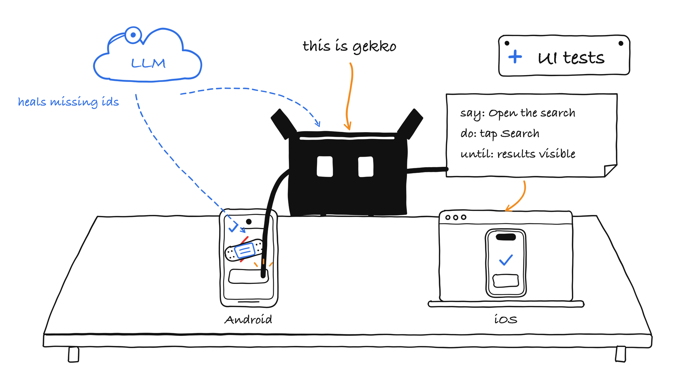
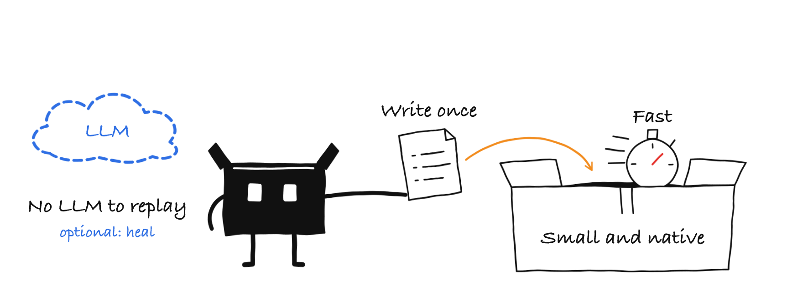
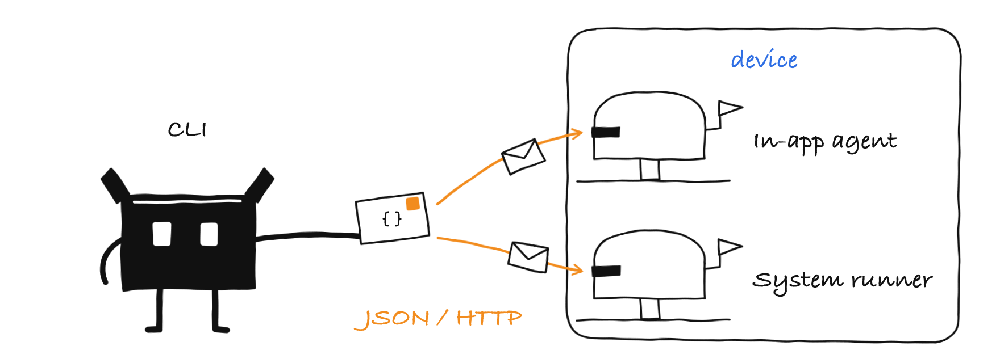
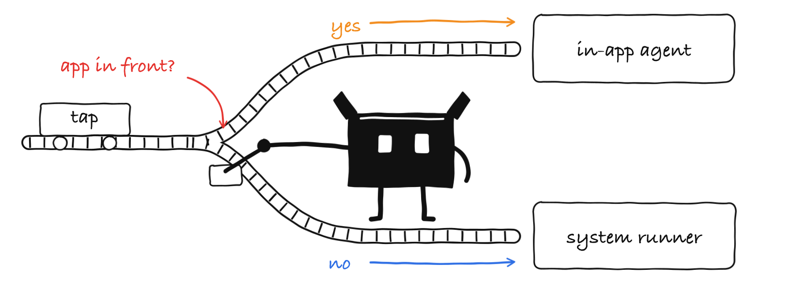
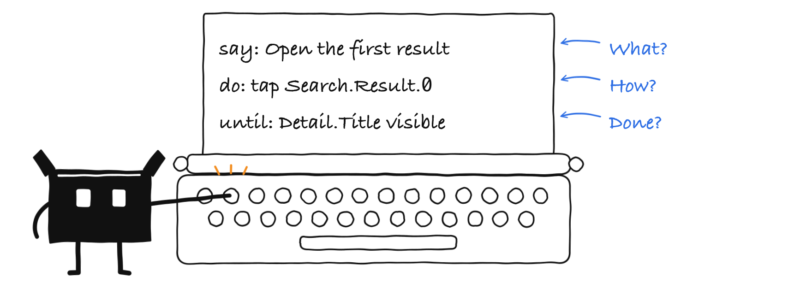
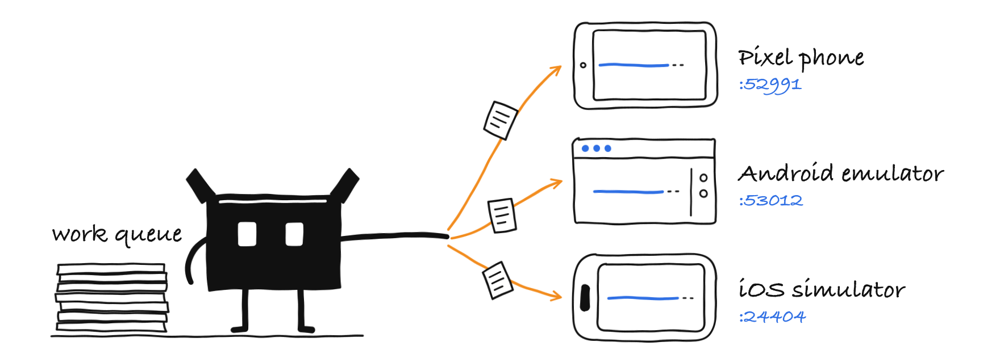
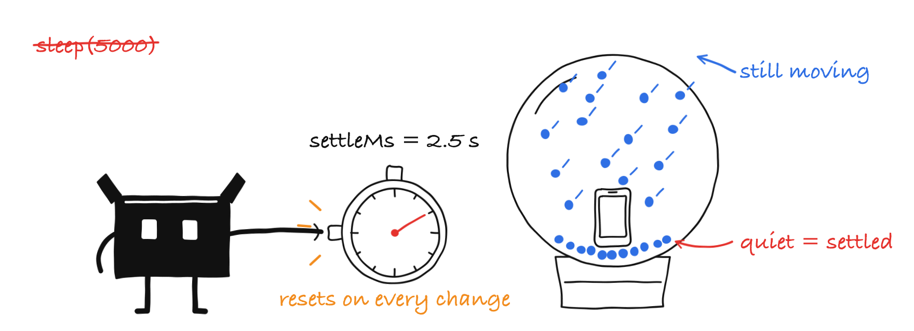
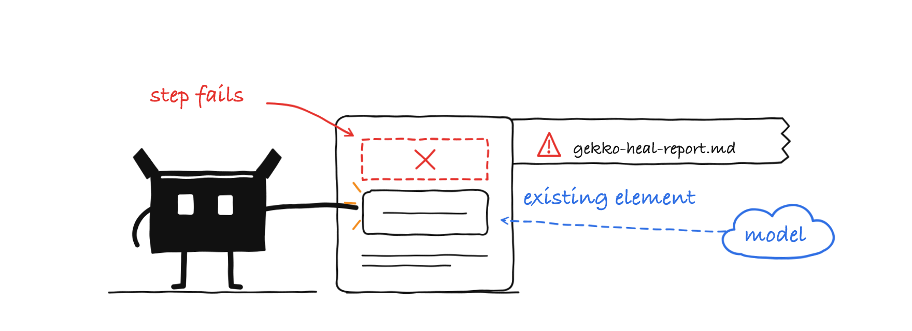
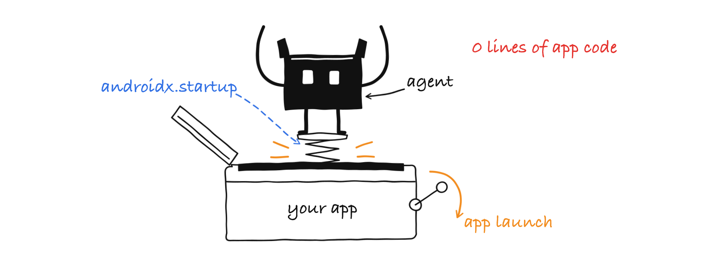
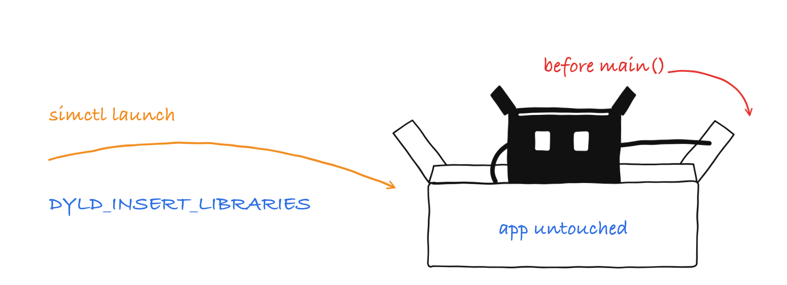

https://github.com/user-attachments/assets/95c2ec31-7283-452a-bca5-328fc3194612

## gekko - what it stands for

**G**enerate and **E**xecute with **K**otlin to **K**eep-green through **O**bservation

| | |
|---|---|
| **G**enerate | Tests start as plain-language intent (`say:`). An LLM (Claude, on the tester's own subscription) explores the real app, picks ids and generates the compiled steps. |
| **E**xecute | The CLI executes the compiled steps deterministically on Android and iOS. CI needs no model to run them. |
| **K**otlin | A native Kotlin CLI, a Kotlin agent for Android and a shared Kotlin protocol. |
| **K**eep-green | Suites stay passing: `--heal` fills in for ids that are missing during a run and reports exactly what it used, and the `gekko-author` skill repairs tests from the failure artifacts and the heal report. |
| **O**bservation | The agent lives inside the app and observes the UI tree directly (ids, texts, actions). It knows when the screen is done loading, so there are no fixed sleeps and no screenshot scraping. |

(A gecko is also fast, light and sticks to every surface it climbs on.)

<p align="center">
  
</p>

## What it does

gekko runs **UI tests written once in YAML on Android and iOS**. It is built to replace slow, hand-written UI-test suites:

- **Fast.** An in-app agent reads the UI tree directly and taps through accessibility actions: steps take 10 ms to about 1 s.
- **Write once.** One test file, shared ids, optional `platform:` on steps, `do` or `until` where the platforms differ.
- **Reusable flows.** Login or onboarding is defined once and reused with `use:`.
- **LLM only where it helps.** A tester describes a scenario; Claude (their own subscription) writes and repairs the steps. CI replays the compiled steps, and no model decides whether a test passes.
- **Self-healing on request.** With `--heal`, a missing id does not fail the run: a model picks the element that fits the step's intent, and a warning lists exactly what was missing and what was used instead.





```
 gekko CLI (Kotlin/Native) ──adb forward / localhost──▶ in-app agent      (Android: androidx.startup · iOS: injected dylib)
        │                                          └─▶ system runner     (Android: UiAutomator · iOS: XCUITest)
        └─ adb / xcrun simctl: launch, fresh state, screenshots            for permission prompts, browser login
```

The CLI chooses the driver per command: the in-app agent while the app has the focus, the system runner for everything outside the app. On Android the agent tells the CLI by itself when the app is not in front, so a command costs one request, and waiting for an element (`assertVisible`) is one request too: the agent polls next to the app instead of sending the tree over the wire.



## A test



```yaml
name: Search
tags: [smoke]
steps:
  - say: Complete the onboarding                  # the tester's intent; stays stable
    do: { use: onboarding-complete }              # reusable flow, named feature-screen-functionality
  - say: Search for a term
    do: { type: { id: Search.Field, value: gekko } }
  - say: Open the first result
    do: { tap: { id: Search.Result.0 } }
    until: { assertVisible: { id: Detail.Title } }    # repeat the tap if it was swallowed
    attempts: 4
  - say: Check that sharing is offered
    platform: android
    do: { assertVisible: { id: Detail.Share.Button } }
```

- **Steps.** `say` (the intent) and `do` (exactly one action: two actions or none is an error when the file loads), optionally `until`, `attempts` (needs `until`), `timeout`, `platform`, `optional` and `if`. A test has `name`, `tags`, `uses` (flows that run before the steps), `timeout` and `device { language, timeFormat }`. Unknown keys are errors too, with a hint.
- **Actions.** `tap`, `doubleTap`, `longPress` (`holdMs`), `type`, `eraseText`, `scroll`, `scrollUntilVisible`, `swipe`, `assertVisible`, `assertNotVisible`, `waitForAnimationToEnd`, `wait`, `back`, `pressKey`, `openLink`, `launchApp` (`clearState`, `arguments: {k: v}` as Android intent extras or iOS launch arguments), `stopApp`, `clearState`, `takeScreenshot`, `setDarkMode`, `setAirplaneMode`, `setOrientation: portrait|landscape` (restored after the test), `setLocation`, `setPermissions`, `copyText`, `hideKeyboard`, `launchPackage`, `stopPackage`, `repeat` and `use` (with `with:`).
- **Selectors.** `id` (shared or `{ android: a, ios: b }`; an id for one platform needs `platform:` on the step), `text`, `textContains`, `textMatches`, `action`, `within`, `index`, `enabled`, `checked`, `selected`. A selector needs `id`, `text`, `textContains`, `textMatches` or `action`; the rest only narrows it down. Also `system: true` on `tap`, `doubleTap` and `longPress` (use the system runner, e.g. for permission dialogs) and, on `tap`, `point: "50%,95%"` (Android only, last resort). Prefer ids: text selectors break on other device languages.
- **Scrolling.** `scroll: { id: List, direction: down, distance: 400 }` scrolls the container; `direction` is where the wanted content is (`down` default, `up`, `start`, `end` following the layout direction including RTL, `left`, `right`), `distance` is in dp (iOS points). `scrollUntilVisible` takes `direction`, `maxScrolls` (10) and `in: { <container selector> }`, stops early at the end of the list and wants the element completely inside its container. `swipe` stays a physical finger gesture: `direction: up|down|left|right` (the finger moves that way; `from: { <selector> }` starts at an element), or `start` and `end` as `x%,y%`, plus `durationMs`.
- **`optional: true`** skips a step only when its element is absent; a failed `until` or a rejected action still fails.
- **Variables.** Flow parameters `${param}` (`params: [..]` in the flow, `with: {..}` at the call), `${var.x}` (kept by `copyText`), `${date(-1,'EEEE, d. MMMM yyyy')}`, `${random.email}`, `${random.number(6)}` and `${random.uuid}` (one value per placeholder and test, printed in the run log). `${env.NAME}` works only for names listed under `env:` in `gekko.yaml`: the value comes from the process environment first, then from a gitignored `.env` next to `gekko.yaml`. A used name without a value is an error (exit 2), also in `gekko check`. Names starting with `GEKKO_`, `GITHUB_`, `ACTIONS_`, `RUNNER_`, `OP_`, `ANTHROPIC_`, `OPENAI_`, `AWS_`, `SONATYPE_`, `GPG_`, `NPM_` or `SSH_` are refused. Every value in use is masked as `***` in the console, JUnit files, `failure.json`, `tree.txt`, heal prompts and reports.

Details: `skills/gekko-author/references/format.md`.

## Using it

```
gekko --version
gekko devices                                      # adb serials and booted simulators
gekko check                                        # read all tests and flows without a device
gekko install build.zip -s <serial|UDID>          # install an .apk, an .app or a zip with an .app (CI build products)
gekko uninstall -s <serial|UDID>                   # remove the app, the system runner and the port forwards
gekko launch --fresh -s <serial|UDID>              # clear data and start the app
gekko tree                                         # what is on screen (ids, texts, actions)
gekko tap --id Search.Field                        # also: type "text", scroll --direction down --distance 400, assert [--gone], screenshot FILE
gekko run --tags smoke --exclude-tags slow         # --exclude-tags is applied after --tags
gekko run tests/search.yaml --platform ios -s <UDID> --junit out.xml
gekko run --shard 2/4 --junit shard-2.xml          # every 4th selected test, starting with the second
gekko run --devices emulator-5554,emulator-5556 --tags smoke       # spread tests over devices
gekko run --devices all --every-device             # every attached device and booted simulator runs every test
gekko run --app build.zip ...                       # install the build first, then run (or --install to use ios.app / android.apk)
gekko run --uninstall ...                          # clean the device up when the run is done
gekko run --record failures ...                    # none, failures or all: video.mp4 next to screenshot.png and tree.txt
gekko run --heal api --junit junit.xml --junit-healed junit-healed.xml ...   # healed steps as failures in a second JUnit file
```

`-s` takes an adb serial or a simulator UDID (the UDID of a booted simulator selects iOS by itself); `--platform android|ios` and `--project DIR` (the directory with `gekko.yaml`) work on every device command. `gekko run` validates all tests and flows like `gekko check` before it starts, writes failure artifacts to `--output` (default `gekko-results/<test>/`: `screenshot.png`, `tree.txt`, `failure.json` with `kind` `test` or `infrastructure`, optional `video.mp4`) and exits with:

| Exit code | Meaning |
|---|---|
| 0 | All tests passed. An empty shard (more shards than tests) exits 0 with a note. |
| 1 | A test failed. |
| 2 | Usage, YAML, configuration or version problem, including a missing `gekko.yaml` (it is required). |
| 3 | Device, agent or system runner problem, or the app crashed. |

- **Fresh start.** Every test starts from cleared app data and quits the app when it is done.
- **Parallel.** Every device gets its own connection (Android: adb forwards the private socket to a free host port; iOS simulators: a stable port per UDID), so Android and iOS, or several devices, run at the same time. `--devices` takes serials and UDIDs, or `all` for every attached device and booted simulator, and hands the tests to the first free device of each platform. Without `--every-device` the devices of one platform share the tests (each test runs once per platform), so with Android and iOS devices together every test runs on both platforms. With `--every-device` every device runs every test instead, and the run passes only when every test passes on every device. Artifacts go to `<output>/<device id>/<test>/`.

  

- **Shards.** `--shard i/n` runs shard i of n: test number i, i+n, i+2n, ... of the selected tests (sorted by path), after `--tags` and `--exclude-tags`. A pull request in a test repository runs the whole suite, split over shards.
- **Device state.** A `device:` block (in `gekko.yaml` for all tests, or at the top of a test to override) sets the app language and the 12h/24h time format for the test and restores them afterwards. The settings are applied after the app data was cleared and before the app starts.
- **Waiting.** The default timeout (`defaultTimeoutMs`) only covers a screen that is still loading. Once the screen is *done* (nothing changed for `settleMs` and no progress indicator is shown) a missing element fails, or heals, immediately.

  

- **Heal.** `--heal` always names where the model comes from, nothing is detected:
  - `--heal claude`: the local `claude` CLI (the tester's own subscription, `haiku` by default), started without tools, MCP servers, project settings or session files, in a private temporary directory.
  - `--heal opencode`: the local `opencode` CLI with the model configured there, running a deny-all agent `gekko-heal` that gekko defines for the call (it cannot read files, run commands or fetch pages; `GEKKO_HEAL_AGENT` opts out). `GEKKO_OPENCODE_COMMAND` replaces the `opencode` binary, e.g. by a launcher.
  - `--heal api`: an OpenAI-compatible endpoint (`GEKKO_LLM_BASE_URL`, `GEKKO_LLM_MODEL`, optional `GEKKO_LLM_API_KEY`; gekko posts to `<base>/chat/completions`) for CI or a remote key. The request goes through `curl` (the native binary has no TLS of its own), so the system's certificates apply; a private CA is named in `GEKKO_LLM_CA_CERT`. It is tested against a fake HTTPS endpoint, not against specific providers: try yours with `gekko llm-check` before you rely on it.
  - `GEKKO_HEAL_MODEL` overrides the model (opencode: `provider/model`). When the named source is not usable (no such CLI on `PATH`, `GEKKO_LLM_*` not set) the run stops with a clear message; when the model is unreachable the step fails as it would without `--heal`.
  - The model only chooses an existing element for a `tap`, `type` or `scroll` step (15 heals per test at most); the kind of the step never changes and typed text always comes from the test. An `assertVisible` is healed only when its id is nowhere in the tree and its texts and states hold on the screen (checked by gekko, not by the model) and the model confirms the screen shows what the step describes; otherwise it fails. Every other step, and every failure that is not a missing element (a wrong state, a timeout), stays a failure. A `tap` with `system: true` (a permission prompt) that finds nothing is skipped and listed in the heal report; no model is asked. Both `do` and `until` are healed: a healed action is followed by its `until` check, and a missing id there is checked like an assertion and reported as its own entry.
  - Model output and app texts are untrusted data: the prompts say so, secrets are masked in them, and the report escapes markdown, HTML and mentions. Healed steps pass with a warning and an entry in `gekko-heal-report.md`. Without `--heal` a missing element fails and the message lists the closest ids and texts on screen (`closest on screen: id=Search.Field ...`), so nothing is ever guessed.

  

- **Healed steps in CI.** A healed step passes, so `--junit` stays all green and has no trace of the heal. `--junit-healed <file>` writes a second JUnit file with one *failed* testcase per healed step (`<test> › <say>`, failure message `<missing id> missing; used <what was used>`, the model's reason as the failure text, the device as `classname` when several devices are used); the file is empty (`tests="0"`) when nothing was healed or `--heal` is not used. Publish both with two JUnit report steps: `junit.xml` as the result check and `junit-healed.xml` as a separate check that only annotates and never fails the job, so every healed id shows up in the pull request. The same data is in `gekko-heal-report.md` for the job summary.

### `gekko.yaml`

`gekko.yaml` is required; gekko looks for it in the current directory or in `--project`.

```yaml
app:
  android: com.example.app
  androidActivity: com.example.app.MainActivity   # when several launcher activities exist
  ios: com.example.app
android:
  permissions: [android.permission.POST_NOTIFICATIONS]   # granted before every fresh start
  runnerApk: installed            # or a path; GEKKO_RUNNER_APK wins. Left out, the installed runner is found anyway
  apk: builds/app-debug.apk       # installed by gekko install and run --install
  stopApps: [com.android.chrome]  # force-stopped before and after every test
ios:
  permissions: [location]         # simctl privacy services
  app: builds/App.zip             # an .app or a zip with an .app
  runnerDir: installed            # or a path; GEKKO_IOS_RUNNER_DIR wins. Left out, the installed runner is found anyway
  agentFramework: installed       # inject the installed agent into the simulator app; or a path; GEKKO_IOS_AGENT wins
device:                   # applied to the device before the app starts, restored after the test
  language: de-DE         # app language (Android per-app locale, iOS launch arguments)
  timeFormat: 24h         # 12h or 24h; a time picker takes 20 only in 24h mode
defaultTimeoutMs: 10000   # waiting for a screen that is still loading
settleMs: 2500            # quiet time after which a screen counts as done (0 = always wait the full timeout)
optionalTimeoutMs: 500    # how long optional steps and if conditions look for their element
tapIntervalMs: 0          # only for apps that throttle clicks, e.g. 650
testsDir: tests
flowsDir: flows
env: [TEST_USER, TEST_PASSWORD]   # the only variables tests may read with ${env.NAME}
```

## Installing

```
curl -fsSL https://raw.githubusercontent.com/jakala-germany/gekko/1.0.0/scripts/install.sh | bash -s -- 1.0.0
gekko --version
```

- **`scripts/install.sh`** (pin the version in the URL and in the argument, or run the script from a checkout; `latest` is the default version) installs the CLI to `$GEKKO_BIN_DIR` (default `~/.local/bin`, put it on your `PATH`) and the runners to `$GEKKO_HOME/runners` (default `~/.gekko/runners`): `gekko-system-runner.apk` and, on macOS, `gekko-ios-runner/` and `gekko-ios-agent/GekkoAgent.framework`. Every download is checked against the `SHA256SUMS` of the release. With `GEKKO_VERIFY_ATTESTATION=1` and the GitHub CLI installed the build provenance is verified as well. `install.sh --uninstall` removes the CLI and the runners again.
- **The CLI finds the installed Android system runner and iOS runner without any setting.** The iOS agent is injected only when you ask for it: `ios.agentFramework: installed` in `gekko.yaml`, or `GEKKO_IOS_AGENT`. `android.runnerApk` and `ios.runnerDir` accept `installed` too. `GEKKO_RUNNER_APK`, `GEKKO_IOS_RUNNER_DIR` and `GEKKO_IOS_AGENT` win over `gekko.yaml`; the setup action sets them in CI.
- **Release assets** on [GitHub](https://github.com/jakala-germany/gekko/releases): `gekko-macos-arm64`, `gekko-linux-x64`, `gekko-system-runner.apk`, `gekko-ios-runner.zip`, `gekko-ios-agent.zip` and `SHA256SUMS`. Verify a download with `gh attestation verify <file> --repo jakala-germany/gekko`.
- **CI:** [`jakala-germany/setup-gekko-cli-action`](https://github.com/jakala-germany/setup-gekko-cli-action) (its tag is the gekko version) installs the CLI and the runners from the release, puts `gekko` on the `PATH` and removes everything when the job is done:

```yaml
- uses: jakala-germany/setup-gekko-cli-action@c34cca53680da0aed1f4b32c9ccfe8913d371958 # 1.0.0
  with:
    version: 1.0.0
    ios: true                                                   # also the iOS runner and agent (macOS runners)
- run: gekko run --tags smoke
```

Every download is verified against the sha256 digest GitHub reports for the release asset, and the step fails when it differs or when the release reports none. The optional inputs `cli-sha256`, `system-runner-sha256`, `ios-runner-sha256` and `ios-agent-sha256` hard-pin a file (the hashes are in `SHA256SUMS`); `token` and `repository` are further inputs (see the action's README). The action exports `GEKKO_RUNNER_APK` (with `ios: true` also `GEKKO_IOS_RUNNER_DIR` and `GEKKO_IOS_AGENT`), so a test repository needs no copy of the runners. Pin the action to the commit of its tag in your workflows.

## Setting up an app





- **Android.** Apply the Gradle plugin to the app module (Maven Central; `mavenCentral()` must be in `pluginManagement` and `dependencyResolutionManagement` repositories). It adds the agent to the variants you list; the agent starts itself and needs no app code:
  ```kotlin
  plugins { id("io.github.jakala-germany.gekko") version "1.0.0" }
  gekko { variants.set(listOf("debug")) }   // build types or full variant names such as stagingDebug; default: debug
  ```
  Without the plugin, depend on the agent directly: `debugImplementation("io.github.jakala-germany:gekko-agent-android:1.0.0")`. The other artifacts are `gekko-protocol`, `gekko-transport-jvm` and `gekko-gradle-plugin` (group `io.github.jakala-germany`). Kotlin and Swift sources keep the package `com.jakala.gekko`.
- **iOS.** Nothing in the app: the CLI injects `GekkoAgent.framework` into the **simulator** app at launch (a Debug simulator build, also one that CI archived and zipped; `gekko install` unpacks the zip and installs the `.app` with the configured bundle id). Ask for the agent with `ios.agentFramework: installed` (or `GEKKO_IOS_AGENT`). The agent stays dormant unless the CLI starts the app (it needs `GEKKO_PORT` and `GEKKO_TOKEN`), so an app started from Xcode or the home screen has no agent. Add `.accessibilityIdentifier(...)` with the same strings as the Android test tags.
- **Versions.** The CLI refuses an agent or system runner with another protocol number and says what to update (the Gradle plugin and a rebuild, or the CLI). Keep the plugin version and the CLI version in step.
- **Skills.** `gekko-setup` wires an Android app, an iOS app or a test repo (including CI workflows); `gekko-author` is the daily loop for writing and repairing tests with Claude.

## Security

- **The agent belongs in the variants you list, never in a build for users.** It can tap anything and read the whole UI; a store build that contains it is a remote control for the app. Listing a non-debuggable variant ships the agent in that build, and that is the developer's decision.
- **Command servers are not reachable by other apps.** On Android the agent and the runner listen on private abstract Unix sockets (`gekko-<appId>`, `gekko-system-runner`) reached through `adb forward`: only adb (shell), root and the app itself may connect, and the agent adds no INTERNET permission. iOS simulators use loopback with a port per simulator; every request needs the per-user token in `~/.gekko/token` (readable by that user only) and a loopback `Host` header without an `Origin`, so other users and web pages are turned away.
- **Test credentials** belong in the environment (`env:` in `gekko.yaml`), never in YAML. Add `.env` and `gekko-results/` to `.gitignore` (the test-repo template of `gekko-setup` does). Values are masked in text output; screenshots and videos are not masked.

## Requirements

- **Host:** macOS arm64 or Linux x64 (iOS needs macOS). The CLI is a native binary and needs no JVM; it starts `adb`, `xcrun`, `unzip` and `perl` (a time limit for every process it starts), which macOS and most Linux distributions have.
- **Android:** `adb` on the `PATH`; the agent needs minSdk 26 (this may be lowered later). Tested with AGP 9.x, Gradle 9.x and Kotlin 2.4.
- **iOS:** simulators only, iOS 15 or newer; Xcode with a simulator (gekko runs `xcrun simctl` and `xcodebuild test-without-building`). Building the runners from source additionally needs `xcodegen`; users take them from the release.
- **Compatibility from 1.0 (semver):** the YAML format, `gekko.yaml`, CLI commands, flags and exit codes, the documented environment variables (not the diagnostic and internal ones, see "Limits"), the Gradle plugin DSL and the Maven coordinates. The protocol between CLI and agents is internal and versioned by its own number.

## Repository layout

| Path | What |
|---|---|
| `protocol/` | Shared command/response/UI-node types, `SettleTracker`, `VisibilityWaiter` |
| `transport-jvm/` | Minimal HTTP command server of the Android agent and runner (over a private socket) |
| `agent-android/` | Android agent (Compose semantics and View hierarchy) |
| `gradle-plugin/` | `io.github.jakala-germany.gekko` plugin |
| `system-runner-android/` | UiAutomator runner |
| `Package.swift`, `agent-ios/` | iOS agent (Swift package, dynamic library) |
| `system-runner-ios/` | XCUITest runner (XcodeGen project) |
| `cli/` | The `gekko` CLI |
| `sample-android/`, `sample-ios/`, `examples/` | Sample apps and tests; CI runs them end to end |
| `skills/` | Claude skills `gekko-setup` and `gekko-author`, with the test-repo and workflow templates |
| `scripts/` | `install.sh` (the installer), `build-ios-runner.sh`, `build-sample-ios.sh`, `e2e-android.sh`, `e2e-ios.sh`, `check-hygiene.sh` |

## Build

```
./gradlew :protocol:jvmTest :cli:jvmTest :transport-jvm:test
(cd gradle-plugin && ../gradlew test)
./gradlew :cli:linkReleaseExecutableMacosArm64 :cli:linkReleaseExecutableLinuxX64
./gradlew :sample-android:assembleDebug :system-runner-android:assembleDebug
./scripts/build-sample-ios.sh        # sample-ios/build/Sample.app
./scripts/build-ios-runner.sh        # dist/gekko-ios-runner and dist/gekko-ios-agent (needs `brew install xcodegen`)
./scripts/e2e-android.sh             # e2e-ios.sh: the sample tests on a running emulator or a booted simulator
./scripts/check-hygiene.sh           # no secrets or internal names in the tracked files
```

JDK 17 builds everything. Kotlin is formatted with [ktfmt](https://github.com/facebook/ktfmt) (kotlinlang style, 120 columns) through the convention plugin `build-logic/src/main/kotlin/gekko-format.gradle.kts`; CI fails on unformatted files: run `./gradlew ktfmtFormat && ./gradlew -p gradle-plugin ktfmtFormat`. The source lives at <https://github.com/jakala-germany/gekko>; changes are listed in [CHANGELOG.md](CHANGELOG.md), contributions are described in [CONTRIBUTING.md](CONTRIBUTING.md).

## In CI

Workflow templates for the `gekko-setup` skill are in `skills/gekko-setup/assets/workflows/`; adapt the repository names (`OWNER/...` placeholders), the Gradle task and the APK path, and pin the actions you use to a commit you have checked. They run on GitHub-hosted `ubuntu-latest` runners with an Android emulator (API 34, KVM switched on by a udev rule); the comment at the top of `run-tests.yml` and `app-ui-tests-smoke.yml` says where to change the runner (`pr.yml` and `nightly.yml` use `run-tests.yml`). Never run pull requests from forks on a self-hosted runner that holds secrets.

- **`app-ui-tests-smoke.yml`** (app repository): on pull requests it builds the debug app and runs the tests tagged `smoke` from the test repository.
- **`run-tests.yml`** (test repository, reusable) with **`pr.yml`** and **`nightly.yml`**: a pull request in the test repository runs the whole suite, split with `--shard i/n` (two shards by default); the nightly run does the same on a schedule. `run-tests.yml` and `app-ui-tests-smoke.yml` run `gekko check` before they start the emulator, so a broken test or a missing `env:` value fails in seconds. `actionlint.yml` is the configuration for the linter.
- **Secrets and variables:** `GEKKO_LLM_BASE_URL` and `GEKKO_LLM_MODEL` (repository variables) and, when the endpoint needs one, `GEKKO_LLM_API_KEY` (secret) for `--heal api`, given to the gekko step only; the test accounts that `env:` in `gekko.yaml` names; optionally `APP_REPOSITORY_TOKEN` / `TESTS_REPOSITORY_TOKEN`, a read-only token to check out a private repository.
- **Heal.** With the model configured, CI runs with `--heal api`; without it the tests run without healing. The main JUnit stays green for healed steps; `--junit-healed` is published as a second check that only annotates and never fails the job. No model decides pass or fail, it only chooses an element, and there are no automatic repair pull requests.
- **Permissions and results:** `contents: read`, plus `checks: write` for the JUnit report (the token of a pull request from a fork is read-only: there the result check cannot be written, the job result still follows the tests); no personal access token. A failed run uploads `gekko-results` (`screenshot.png`, `tree.txt`, `failure.json`, `video.mp4` from `--record failures`) as an artifact for 14 days (they can show the UI of the app); `gekko-heal-report.md` goes to the job summary.

This repository's own CI (`.github/workflows/ci.yml`, GitHub-hosted runners) runs hygiene (secrets scan, actionlint), unit tests, the Apple build and tests and the Android end-to-end run on every pull request, and the iOS end-to-end run on `main` and before a release.

## Releasing

A release is a tag `X.Y.Z` on `main`. `.github/workflows/release.yml` runs the checks and builds, waits for the approval of the `release` environment, attests the build provenance, creates the GitHub draft release (binaries, runners and `SHA256SUMS`), publishes to Maven Central and then publishes the release. Steps and one-time setup: [RELEASE.md](RELEASE.md).

## Limits

- iOS works on **simulators only** in 1.0.
- The agent needs ids. Missing ids can be worked around with `--heal`, but the durable fix is a tag or identifier in the app.
- On iOS a tap through accessibility can be a no-op for SwiftUI tap gestures; retries (`attempts` with `until`) and `--heal` use a real touch through the system runner.
- Some actions are Android only: `back`, `pressKey`, `setAirplaneMode`, `launchPackage`, `stopPackage`; limit such steps with `platform: android`. `setLocation` needs an emulator on Android.
- Environment variables: `GEKKO_RUNNER_APK`, `GEKKO_IOS_RUNNER_DIR`, `GEKKO_IOS_AGENT` (win over `gekko.yaml`), `GEKKO_HOME` (where the installed runners are, `$GEKKO_HOME/runners`; default `~/.gekko`), `GEKKO_LLM_BASE_URL`, `GEKKO_LLM_MODEL`, `GEKKO_LLM_API_KEY`, `GEKKO_LLM_CA_CERT`, `GEKKO_HEAL_MODEL`, `GEKKO_HEAL_AGENT`, `GEKKO_OPENCODE_COMMAND`. For the install script (besides `GEKKO_HOME`): `GEKKO_BIN_DIR` (default `~/.local/bin`), `GEKKO_VERIFY_ATTESTATION` and `GEKKO_RELEASE_BASE_URL` (the CLI does not read them). `GEKKO_DEBUG` (logs the driver per command and the steps skipped on this platform) and `GEKKO_HEAL_DEBUG` (a directory that receives the heal prompts) are for diagnosing. `GEKKO_PORT`, `GEKKO_TOKEN`, `GEKKO_TARGET_BUNDLE_ID` (the CLI sets them for the iOS agent and runner) and `GEKKO_TAP_VERIFY` (a switch of the iOS agent) are internal: do not set them yourself. The diagnostic and internal variables are not covered by the compatibility promise.
- A page with an endless animation (Lottie, spinner) never gets idle. The Android agent waits at most 500 ms for idle before it looks for the element, so such pages cost no more than that per step. A loading skeleton that is not a progress indicator counts as a settled screen after `settleMs`; raise `settleMs` for slow networks.

## License

Apache License 2.0, see [LICENSE](LICENSE). Contributions: [CONTRIBUTING.md](CONTRIBUTING.md); report vulnerabilities as described in [SECURITY.md](SECURITY.md).
