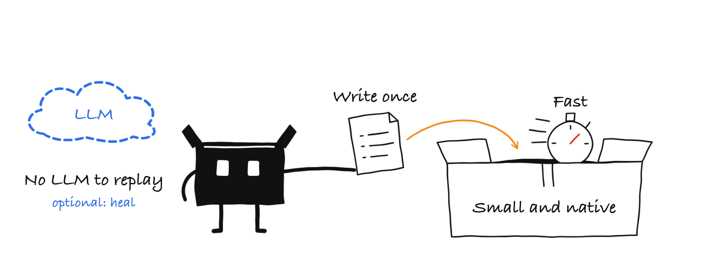
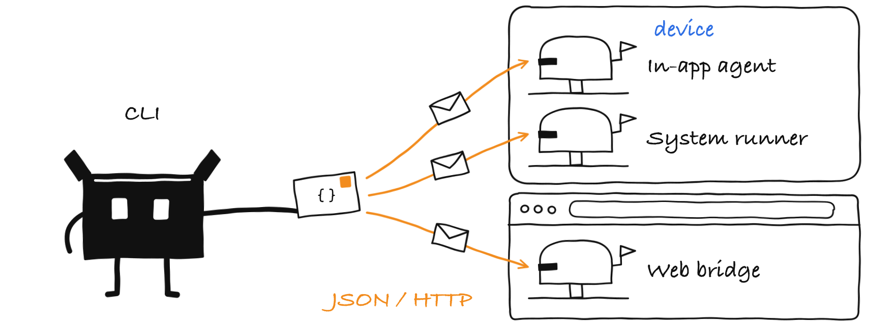
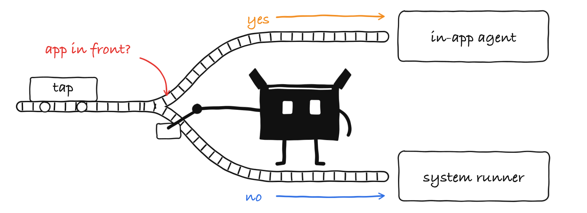
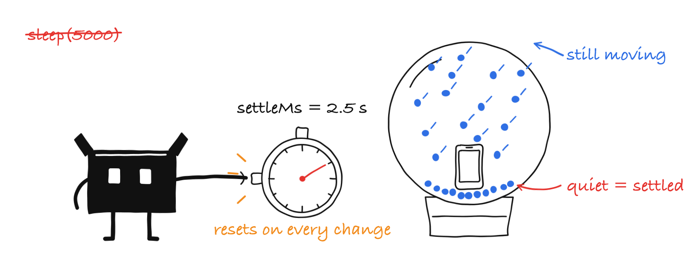
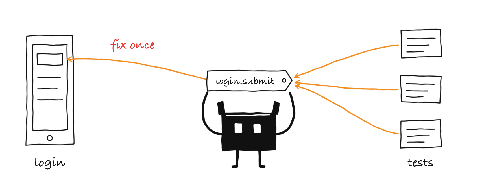
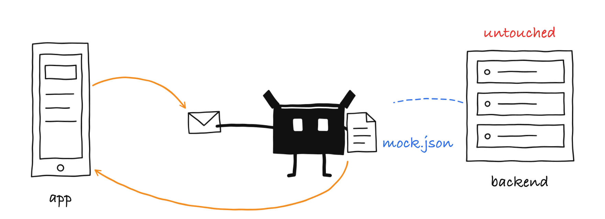
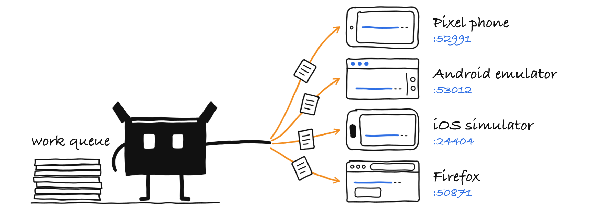

# How gekko works

The background to the [README](../README.md): what the name stands for, how the CLI talks to the app, how gekko decides that a screen is done, how it runs on several devices and in groups and where its limits are. Commands, flags and keys are in the [CLI reference](../skills/gekko-setup/references/cli.md), the YAML format in the [format reference](../skills/gekko-author/references/format.md).

## The name

**G**enerate and **E**xecute with **K**otlin to **K**eep-green through **O**bservation

| Letter | Meaning |
|---|---|
| **G**enerate | Tests start as plain-language intent (`say:`). An LLM (Claude, on the tester's own subscription) explores the real app, picks ids and generates the compiled steps. |
| **E**xecute | The CLI executes the compiled steps deterministically on Android, iOS and in the browser. CI needs no model to run them. |
| **K**otlin | A native Kotlin CLI, a Kotlin agent for Android, a shared Kotlin protocol and, for the web, a small Node bridge around Playwright. |
| **K**eep-green | Suites stay passing: `--heal` fills in for ids that are missing during a run and reports exactly what it used, and the `gekko-author` skill repairs tests from the failure artifacts and the heal report. |
| **O**bservation | On Android and iOS the agent lives inside the app, on the web a script injected into the page does the same: it observes the UI tree directly (ids, texts, actions). gekko knows when the screen is done loading, so there are no fixed sleeps and no screenshot scraping. |

A gecko is also fast, light and sticks to every surface it climbs on.

## Design constraints

gekko is a small native binary that executes a YAML sheet against the device or the browser. The model is an optional extra for healing, never part of the run.



## Architecture

The CLI posts JSON commands to two small servers on the device: the in-app agent and the system runner. On the web it talks to a bridge that drives the browser.



```text
 gekko CLI (Kotlin/Native) ──adb forward / localhost──▶ in-app agent      (Android: androidx.startup · iOS: injected dylib)
        │                                          └─▶ system runner     (Android: UiAutomator · iOS: XCUITest)
        ├─ adb / xcrun simctl: launch, fresh state, screenshots            for permission prompts, browser login
        └─ localhost ──▶ web bridge (Node, Playwright) ──▶ browser         (page script injected into every page)
```

## Choosing the driver

The CLI chooses the driver per command: the in-app agent while the app has the focus, the system runner for everything outside the app.

- On Android the agent tells the CLI by itself when the app is not in front, so a command costs one request.
- Waiting for an element (`assertVisible`) is one request too: the agent polls next to the app instead of sending the tree over the wire.



### On the web

Nothing goes into the app under test: gekko starts the browser through Playwright (a small Node bridge it ships and starts itself) and injects a page script that only reads the page. Which element a selector means, what is on screen and when the screen is done changing is decided in the CLI with the code the Android agent uses, so a test fails and heals the same way everywhere.

A web "device" is a named browser session (`chromium`, `firefox`, `webkit`; `chromium-2` for more of one) that outlives a CLI call, so `gekko launch`, `gekko tree` and `gekko tap` work step by step like on a device.

## Who may answer

A server on a port or a socket can be taken by whoever binds it first: another app on the phone, another process or user on the machine. gekko does not trust the connection, it trusts a key. Every request carries a fresh nonce and an HMAC of its endpoint, the session of the server, the nonce and the body, and every answer carries an HMAC of the same nonce, its status and its body. The key itself never goes over the connection. The CLI does not believe an answer that is not signed for its request, so a program that sits on the port cannot fail a test, return a fake tree or collect the token: the run stops with an error that names the port.

The session is a random id that a server picks when it starts and names in its signed answer to `hello`. Every other command carries it, so a request recorded against a fake server is worthless against the real one, and one from before an app restart is worthless afterwards.

- **iOS simulators and web:** the key is the per-user token in `~/.gekko/token`, handed to the agent, the runner and the bridge when the CLI starts them.
- **Android:** every socket has a key of its own, derived from the token. The agent reads it from a file in the private directory of the app, which the CLI writes with `run-as` (so the agent needs a debuggable build); the system runner gets it as an argument of `am instrument`. No other app can read either.
- **Text from the app:** ids, texts and error messages come from the app under test and can hold escape sequences that a terminal acts on. The CLI turns every control character into a visible escape (`\u001b`) before it prints it or writes `tree.txt`, `failure.json` and the other artifacts, so `cat tree.txt` after a failed run is safe.

## Waiting for a settled screen

The default timeout (`defaultTimeoutMs`) only covers a screen that is still loading. Once the screen is *done* (nothing changed for `settleMs` and no progress indicator is shown) a missing element fails, or heals, immediately.



Pages that never settle:

- A page with an endless animation (Lottie, spinner) never gets idle. The Android agent waits at most 500 ms for idle before it looks for the element, so such pages cost no more than that per step.
- A loading skeleton that is not a progress indicator counts as a settled screen after `settleMs`. Raise `settleMs` for slow networks.

## Panes

A test that repeats `Login.Submit` in thirty places breaks in thirty places. A pane is a screen written once, in `panes/<name>.yaml`: its elements (named selectors, per platform where they differ), its identity (the elements that prove it is shown) and its actions (named steps with params). The rules are in the [format reference](../skills/gekko-author/references/format.md#panes).



Panes exist only in the CLI. A reference such as `tap: auth/login.submit` is turned into the plain selector of the platform the step runs on just before the step runs (the keys of the step are added to the element's), so the agents, the protocol and the wire format know nothing about panes and a test written with panes behaves exactly like one with the ids spelled out. That is also why a pane is YAML and not a script: it is read by the strict parser like every other file, so `gekko check` can name an unknown element, an element a platform lacks or a mistyped param without a device.

A pane action starts on its pane: before its steps it waits for the pane's identity, so a test that arrives on the wrong screen fails with `not on pane 'auth/login'` instead of a missing element deep in the action. When a step fails, gekko looks at the screen it already captured and names the panes whose identity holds (`current pane: home`), and the heal report points at the element and the file to change.

## Network mocks

Some backend answers are hard to provoke (an error, a slow answer, an empty list). A test can say what the backend answers instead, with a `mock` step, and the app needs no code and no update for it. The steps and keys are in the [format reference](../skills/gekko-author/references/format.md#network-mocks), and which clients and platforms are covered is listed under [where mocks work](../skills/gekko-author/references/format.md#where-mocks-work).



The mocks are held by whatever makes the app's requests, and the CLI tells it what to answer:

- **Android.** The Gradle plugin makes every `OkHttpClient` carry one more interceptor and every `URL.openConnection()` of the app and its libraries go through the agent, in the variants that get the agent (`gekko { networkMocks.set(false) }` turns it off). The agent answers a matching request itself and hands every other one on, so nothing changes while no test sets a mock.
- **iOS simulators.** The injected agent registers a `URLProtocol` and puts it first in every `URLSession` configuration, so everything on `URLSession` is covered, Alamofire and Apollo included.
- **Web.** The bridge answers matching requests of the browser context with Playwright's `route`.

The mocks reach the app in one of two ways. While the app runs, the CLI sends them over the connection it uses anyway. Mocks at the start of a test have to be there before the app makes its first request, so the CLI writes them to a file that the agent reads while the app starts and then deletes (Android: the private directory of the app, through `run-as`; iOS: a file of the simulator host named in the launch environment) or, on the web, to the bridge. Nothing is left on the device: a test removes every mock when it ends, in every outcome, and a file that no start picked up is deleted.

## Running on several devices

`gekko run --devices` gives every device its own connection, so Android, iOS and the web, or several devices, run at the same time.

- **Connections.** Android: adb forwards the private socket to a free host port. iOS simulators: a stable port per UDID. Web: one bridge per browser session.
- **Which devices.** `--devices` takes serials, UDIDs and browsers (`chromium,firefox,webkit`), or `all` for every attached device, booted simulator and running web session, and hands the tests to the first free device of each platform.
- **Default.** The devices of one platform share the tests, so each test runs once per platform. With Android, iOS and web devices together every test runs on every platform.
- **`--every-device`.** Every device runs every test, and the run passes only when every test passes on every device.
- **Artifacts.** They go to `<output>/<device id>/<test>/`.



### Shards

`--shard i/n` runs shard i of n: test number i, i+n, i+2n, ... of the selected tests (sorted by path), after `--tags` and `--exclude-tags`. A pull request in a test repository runs the whole suite, split over shards.

### Groups

A folder with a `group.yaml` is a group: its `setup:` flows (a login) run once in a fresh start, then its tests run one after the other without clearing the app data (a browser keeps its context), so the login is still there in every test. If the setup fails, the tests of the group are reported as `SKIP` instead of failing one by one. A group stays on one device, in one shard and in order, and `--record` does not record it. The rules of the `group.yaml`: [format reference](../skills/gekko-author/references/format.md).

## Limits

- iOS works on **simulators only**; real devices are not supported yet.
- A TV (Android TV / Google TV, Apple TV simulators) is driven with the remote: there is no touch, so `tap`, `scroll`, `swipe`, `drag`, `longPress` and `doubleTap` fail there and `type` needs the focus on the field. The remote buttons are pressed by the system runner (an app cannot inject key events into its own window): on Android through UiAutomator key codes, on tvOS through `XCUIRemote`, which needs the system runner for the tvOS simulator. Where the focus is comes from the same tree as everything else (`focused`); the iOS agent reads it from the focus engine on an Apple TV and from the keyboard focus on an iPhone.
- The agent needs ids. Missing ids can be worked around with `--heal`, but the durable fix is a tag or identifier in the app (a `data-testid` on the web).
- On iOS a tap through accessibility can be a no-op for SwiftUI tap gestures. Retries (`attempts` with `until`) and `--heal` use a real touch through the system runner.
- `launchPackage` and `stopPackage` are Android only; `setAirplaneMode` works on Android and the web, not on iOS simulators, and `back` and a `pressKey` with a key code do not work on iOS simulators either (`enter`, `backspace`, `tab` and `home` do). Limit such steps with `platform: android` or a list such as `platform: [android, web]`.
- Some Android settings need a newer API level: `setDarkMode` needs API 29, `setAirplaneMode` API 30 and the `device.language` setting API 33. An older device fails the step with a message.
- `setLocation` works on emulators (console), physical devices (the system runner feeds Android's mock location providers; no setting needed) and iOS simulators.
- Web: Chromium, Firefox and WebKit through Playwright only, desktop browsers (a `web.device` emulates a phone's viewport and user agent, not its touch). The page script reads open shadow roots and iframes; a closed shadow root is invisible to it. A browser caps one mouse-wheel turn (Firefox: about a page), so long scrolls are sent in steps. Native pickers (the dropdown of a `<select>`, the date picker) are not part of the page: set a `<select>` or a date field with `type`.
- A group shares its start state between its tests, which therefore depend on each other's order (see [Groups](#groups)).
- Network mocks reach OkHttp and `HttpURLConnection` on Android (a debuggable build with the Gradle plugin), `URLSession` on iOS simulators, and every request of a page on the web. They do not reach Flutter, Cronet, gRPC, Ktor with the CIO engine or content in a `WebView` on Android, `WKWebView` and Flutter on iOS, or requests a service worker answers on the web. There is no way to mock on a real iPhone, because iOS runs on simulators only. The full list of what works where is in the [format reference](../skills/gekko-author/references/format.md#where-mocks-work).
